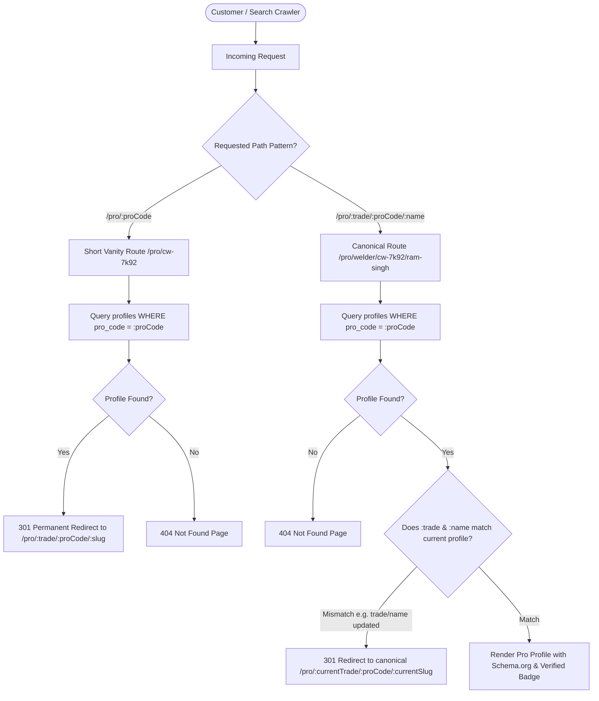

# Service Professional Profile Links & Collision Architecture Walkthrough

## 1. Executive Summary

This walkthrough document specifies the architecture, routing hierarchy, database schema, and implementation plan for **Service Professional Profile Links** on Carpenterwala.

### The Problem
When service professionals share the same name (for example, two carpenters named **"Ram Singh"**):
1. **Sequential Slug Collisions**: The legacy generator creates `ram-singh` for the first pro and `ram-singh-1`, `ram-singh-2` for subsequent pros. This makes second and third pros appear secondary, diminishes trust, and exposes sequential counters to competitors.
2. **Same City / Same Trade Duplicates**: Even if location or trade is appended (`ram-singh-carpenter-koramangala`), having two pros with the same name in the same locality causes the collision problem to resurface.
3. **Branding & Offline Shareability**: Pros need a clean, recognizable identity on physical visiting cards, Carpenterwala branded T-shirts, invoices, WhatsApp links, and SMS booking confirmations.

### The Solution: Branded Pro Code Hierarchical URLs
We implement a **Branded Pro Code Architecture** combined with a hierarchical SEO path:
```
Canonical Profile URL: https://carpenterwala.com/pro/[trade]/[pro_code]/[name]
Example:               https://carpenterwala.com/pro/welder/cw-7k92/ram-singh

Short-Link Vanity URL: https://carpenterwala.com/pro/cw-7k92
Behavior:              Instantly resolves & 301 redirects to the canonical profile URL
```

---

## 2. Key Architecture & Design Alignment

| Requirement | Implementation Decision | Rationale |
| :--- | :--- | :--- |
| **Canonical URL Format** | `/pro/[trade]/[pro_code]/[name]` | Establishes clear breadcrumbs (`Home > Pro > Trade > Pro Name`), optimizes local search rankings, and eliminates top-level route clutter. |
| **Case Standard** | All-lowercase (e.g. `cw-7k92`) | Enforces Google SEO best practices; eliminates duplicate content issues caused by mixed-casing. |
| **Pro Code Format** | `CW-[4-ALPHANUMERIC]` (e.g. `CW-7K92`, `CW-4M8P`) | $36^4 \approx 1.68\text{M}$ unique combinations per namespace. Uniquely identifiable, memorable, and safe from enumeration scraping. |
| **Collision Resolution** | $100\%$ Guaranteed Uniqueness | Every pro has a distinct, permanent Pro Code. Zero collisions even if 100 pros share the exact same name, trade, and city. |
| **Database Lookup** | $O(1)$ Direct Index on `pro_code` | Eliminates expensive `LIKE` queries and while-loop collision checking during onboarding. |
| **Profile Edits** | Permanent Pro Code, Dynamic Slug | If a pro updates their display name or primary trade, their Pro Code remains permanent while the URL dynamically updates. |
| **Short-Link Sharing** | `/pro/[proCode]` $\rightarrow$ 301 Redirect | Compact vanity URL for visiting cards, SMS updates, WhatsApp sharing, and QR codes. |
| **Migration Strategy** | Fresh Cutover | All newly registered and migrated pros immediately adopt the `/pro/...` hierarchy. |

---

## 3. URL Routing & Resolution Flow



---

## 4. Collision & Edge Case Scenarios

### Scenario A: Two Service Pros with Identical Names in the Same Locality
- **Pro 1**: Ram Singh (Welder in Koramangala) $\rightarrow$ `CW-7K92`
  - URL: `https://carpenterwala.com/pro/welder/cw-7k92/ram-singh`
  - Short URL: `https://carpenterwala.com/pro/cw-7k92`
- **Pro 2**: Ram Singh (Welder in Koramangala) $\rightarrow$ `CW-3V5X`
  - URL: `https://carpenterwala.com/pro/welder/cw-3v5x/ram-singh`
  - Short URL: `https://carpenterwala.com/pro/cw-3v5x`

### Comparison Matrix

| Approach | URL Example | Collision Safety | Customer Perception | SEO & Breadcrumbs |
| :--- | :--- | :--- | :--- | :--- |
| **Legacy Sequential** | `carpenterwala.com/ram-singh-1` | ⚠️ Poor (Fails at scale) | ❌ Feels like second-class copy | ❌ No category breadcrumb |
| **Semantic Only** | `carpenterwala.com/ram-singh-welder-koramangala` | ⚠️ Fails if 2 pros in same area | ⚠️ Overly long URL | ⚠️ Flat structure |
| **Pure Random Slug** | `carpenterwala.com/pro/9f2b8k4m` | ✅ Safe | ❌ Unreadable, zero SEO context | ❌ Zero keyword value |
| **Carpenterwala Branded Architecture** | **`carpenterwala.com/pro/welder/cw-7k92/ram-singh`** | **✅ 100% Safe Forever** | **⭐️ Official, prestigious, verifiable** | **⭐️ Rich Breadcrumb & Keyword Hierarchy** |

---

## 5. Database Schema & Migration Plan

### 5.1 Schema Alteration
Add `pro_code` column with a unique index:

```sql
-- Migration: Add pro_code to profiles
ALTER TABLE public.profiles
ADD COLUMN IF NOT EXISTS pro_code VARCHAR(16) UNIQUE;

-- Create fast lookup index
CREATE UNIQUE INDEX IF NOT EXISTS idx_profiles_pro_code ON public.profiles (LOWER(pro_code));
```

### 5.2 Backfill Script for Existing Profiles
```sql
-- Generate Pro Code for any existing profiles missing one
UPDATE public.profiles
SET pro_code = 'CW-' || UPPER(SUBSTRING(MD5(RANDOM()::TEXT) FROM 1 FOR 4))
WHERE pro_code IS NULL;

-- Enforce NOT NULL constraint once backfilled
ALTER TABLE public.profiles ALTER COLUMN pro_code SET NOT NULL;
```

---

## 6. Codebase Implementation Blueprint

### 6.1 Pro Code & Slug Utility (`lib/pro-slug.js`)
Centralized utility for generating Pro Codes and formatting canonical URLs:

```javascript
import crypto from 'crypto';

/**
 * Generates an uppercase 4-character alphanumeric Pro Code (e.g. CW-7K92)
 * Excludes ambiguous characters (0, O, 1, I) for readability.
 */
export function generateProCode() {
  const chars = '23456789ABCDEFGHJKLMNPQRSTUVWXYZ';
  let randomPart = '';
  const randomBytes = crypto.randomBytes(4);
  for (let i = 0; i < 4; i++) {
    randomPart += chars[randomBytes[i] % chars.length];
  }
  return `CW-${randomPart}`;
}

/**
 * Normalizes a professional name into a clean, URL-safe slug.
 */
export function toUrlSlug(name) {
  if (!name) return 'pro';
  return name
    .trim()
    .toLowerCase()
    .replace(/[^a-z0-9]+/g, '-')
    .replace(/(^-|-$)/g, '') || 'pro';
}

/**
 * Normalizes trade name into URL-safe path component.
 */
export function toTradeSlug(trade) {
  if (!trade) return 'services';
  return trade
    .trim()
    .toLowerCase()
    .replace(/[^a-z0-9]+/g, '-')
    .replace(/(^-|-$)/g, '') || 'services';
}

/**
 * Builds the canonical public profile URL for a professional.
 */
export function getProUrl(profile) {
  if (!profile) return '/find-a-professional';
  const trade = toTradeSlug(profile.trade);
  const code = (profile.pro_code || 'cw-0000').toLowerCase();
  const nameSlug = toUrlSlug(profile.name);
  return `/pro/${trade}/${code}/${nameSlug}`;
}
```

### 6.2 Onboarding Integration (`app/api/pro/otp/route.js`)
Replace the slow `while(true)` collision loop with instant $O(1)$ Pro Code generation:

```javascript
import { generateProCode, toUrlSlug } from '@/lib/pro-slug';

// Generate unique Pro Code & slug
let proCode = generateProCode();
while (true) {
  const { data: existing } = await supabase
    .from('profiles')
    .select('id')
    .eq('pro_code', proCode)
    .maybeSingle();
  if (!existing) break;
  proCode = generateProCode();
}

const slug = toUrlSlug(decrypted.name);

// Insert profile with guaranteed uniqueness
const { data: newProfile, error: insertError } = await supabase
  .from('profiles')
  .insert({
    pro_code: proCode,
    slug: slug,
    name: decrypted.name,
    email: cleanEmail,
    phone: cleanDecryptedPhone || decrypted.phone,
    trade: decrypted.trade,
    location: decrypted.location,
    verified: false,
    onboarding_completed: false,
  });
```

### 6.3 Next.js Route Hierarchy

```
app/
├── pro/
│   ├── [trade]/
│   │   └── [proCode]/
│   │       └── [name]/
│   │           └── page.js         <-- Canonical Profile Page
│   └── [proCode]/
│       └── page.js                 <-- Vanity Short-Link (301 Redirect to Canonical)
```

#### Canonical Page (`app/pro/[trade]/[proCode]/[name]/page.js`)
```javascript
import { getProfileByProCode } from '@/lib/supabase';
import { getProUrl } from '@/lib/pro-slug';
import { redirect, notFound } from 'next/navigation';

export async function generateMetadata({ params }) {
  const { proCode } = await params;
  const profile = await getProfileByProCode(proCode.toUpperCase());
  if (!profile) return { title: 'Not Found' };

  const canonicalUrl = `https://carpenterwala.com${getProUrl(profile)}`;
  const title = `${profile.name} (ID: ${profile.pro_code}) - Verified ${profile.trade} in ${profile.location} | Carpenterwala`;
  
  return {
    title,
    description: `Hire ${profile.name}, verified ${profile.trade} (Pro ID: ${profile.pro_code}) in ${profile.location}.`,
    alternates: { canonical: canonicalUrl },
  };
}

export default async function ProProfilePage({ params }) {
  const { trade, proCode, name } = await params;
  const profile = await getProfileByProCode(proCode.toUpperCase());
  if (!profile) notFound();

  // If URL trade or name was modified/outdated, 301 redirect to current canonical URL
  const canonicalUrl = getProUrl(profile);
  const currentPath = `/pro/${trade.toLowerCase()}/${proCode.toLowerCase()}/${name.toLowerCase()}`;
  if (currentPath !== canonicalUrl) {
    redirect(canonicalUrl);
  }

  return (
    <ProfileView profile={profile} />
  );
}
```

#### Short-Link Vanity Page (`app/pro/[proCode]/page.js`)
```javascript
import { getProfileByProCode } from '@/lib/supabase';
import { getProUrl } from '@/lib/pro-slug';
import { redirect, notFound } from 'next/navigation';

export default async function ProShortLinkPage({ params }) {
  const { proCode } = await params;
  const profile = await getProfileByProCode(proCode.toUpperCase());
  if (!profile) notFound();

  // 301 Permanent Redirect to canonical SEO URL
  redirect(getProUrl(profile));
}
```

---

## 7. SEO, Breadcrumbs & Structured Data

### BreadcrumbList JSON-LD
```json
{
  "@context": "https://schema.org",
  "@type": "BreadcrumbList",
  "itemListElement": [
    {
      "@type": "ListItem",
      "position": 1,
      "name": "Home",
      "item": "https://carpenterwala.com"
    },
    {
      "@type": "ListItem",
      "position": 2,
      "name": "Welder Services",
      "item": "https://carpenterwala.com/services/welder"
    },
    {
      "@type": "ListItem",
      "position": 3,
      "name": "Ram Singh (CW-7K92)",
      "item": "https://carpenterwala.com/pro/welder/cw-7k92/ram-singh"
    }
  ]
}
```

### LocalBusiness / Person JSON-LD
```json
{
  "@context": "https://schema.org",
  "@type": "Person",
  "name": "Ram Singh",
  "identifier": "CW-7K92",
  "jobTitle": "Welder",
  "worksFor": {
    "@type": "Organization",
    "name": "Carpenterwala",
    "url": "https://carpenterwala.com"
  },
  "url": "https://carpenterwala.com/pro/welder/cw-7k92/ram-singh"
}
```

---

## 8. Rollout & Verification Checklist

- [ ] **Database Migration**: Run migration to add `pro_code` and populate existing records.
- [ ] **Utility Integration**: Add `lib/pro-slug.js` with test coverage for code generation and slug formatting.
- [ ] **Onboarding APIs**: Update `otp/route.js` and `social-complete/route.js` to assign `pro_code` on sign-up.
- [ ] **Route Handlers**: Create `app/pro/[trade]/[proCode]/[name]/page.js` and `app/pro/[proCode]/page.js`.
- [ ] **Directory Link Updates**: Update profile card links in `app/find-a-professional/page.js` to call `getProUrl(pro)`.
- [ ] **Pro Dashboard**: Display the pro's official Pro Code and "Copy Profile Link" widget in the Pro Dashboard.
- [ ] **Sitemap Update**: Ensure `app/sitemap.js` indexes profiles using their canonical `/pro/[trade]/[proCode]/[name]` URLs.
- [ ] **SEO & Canonical Check**: Validate that canonical meta tags and OpenGraph tags render accurately.
